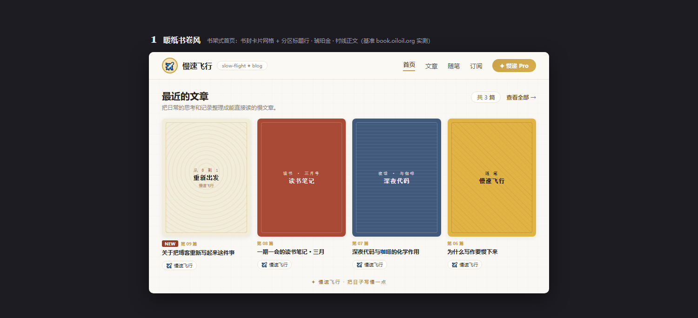
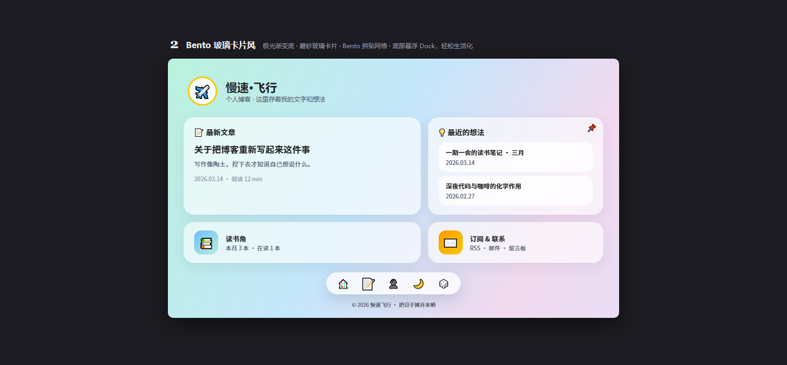
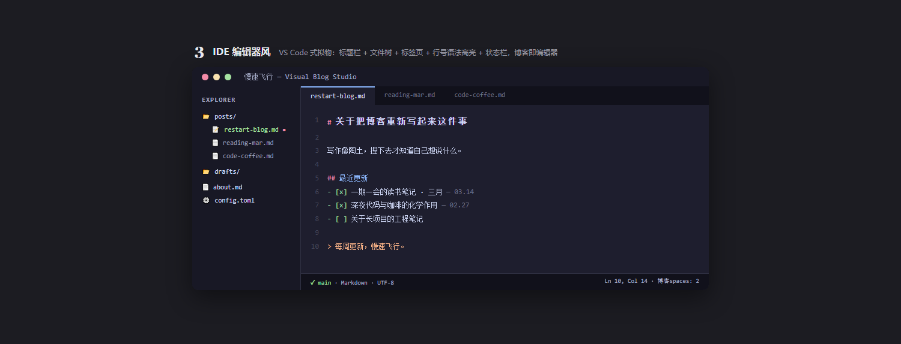

# blog-style-designer · 个人博客风格设计师

> 一个让 AI 通过「看图选择」帮你设计个人博客 UI 风格的 Agent Skill。
> 每一步都生成 HTML 对比预览页供你直接挑选，最终把确认结果沉淀为一份可直接交给任何 AI / 开发者的《UI 风格 MD 文档》。

一个面向 WorkBuddy / Claude Code 类 Agent 的 Skill（`SKILL.md` + references 结构）。

## 它解决什么问题

「帮我设计一个博客风格」这种一句话需求，产出往往全凭 AI 一次发挥——你只能看结果，无法参与。blog-style-designer 把设计过程拆成 **7 步收敛流程**，每一步都渲染成真实的 HTML 预览页让你横向对比，你只需要回复编号或一句话描述倾向：

```
第1步 风格选择（5选1）→ 第2步 风格实现（该风格3种做法选1）
  ↓
第3步 配色选择（5组选1）→ 第4步 配色实现（该配色3种应用选1）
  ↓
第5步 导航选择（4选1）→ 第6步 导航实现（该导航3种细化选1）
  ↓
第7步 高保真首页（3版不同诠释选1 → 可微调循环直到"确认"）
  ↓
沉淀《UI 风格 MD 文档》
```

**Skill 产出的页面截图** —— 每一步都是真实渲染的 HTML 对比页，以下是内置风格库中三种风格的预览效果（同一份虚构博客内容）：

**风格 1 · 暖纸书卷风**（基准 book.oiloil.org：书架式首页、书封卡片网格、暖纸底 + 琥珀金）：



**风格 2 · Bento 玻璃卡片风**（极光渐变底、磨砂玻璃卡、底部悬浮 Dock）：



**风格 3 · IDE 编辑器风**（VS Code 拟物：文章=文件、行号语法高亮）：



- 所有候选渲染**同一份虚构博客内容**，保证对比公平
- 实现步的 3 个候选必须在排版结构 / 色彩策略 / 装饰手法 / 密度节奏上**方向性不同**，禁止只改字号的同质选项
- 随时可以说「你帮我定」（跳轮）、「回到第 X 步」（回退）、「直接走」（跳过实现步）
- 唯一交付物是 `blog-style-guide.md`：视觉规范 + 组件规范 + CSS Tokens（`--blog-*` 变量与可复用样式片段），脱离本 Skill 也能还原整套风格

## 内置 5 种风格

| # | 风格 | 一句话 |
|---|---|---|
| 1 | 暖纸书卷风 | 基准 book.oiloil.org：书架式首页、书封卡片网格、暖纸底 + 琥珀金（参数实测锁定） |
| 2 | Bento 玻璃卡片风 | 参考 mumingfang.com：极光渐变底、磨砂玻璃卡、底部悬浮 Dock |
| 3 | IDE 编辑器风 | VS Code 拟物：文章=文件、Catppuccin Mocha 配色、行号语法高亮 |
| 4 | 瑞士极简风 | 纯白、编号网格、大字重无衬线，克制到极致 |
| 5 | 复古海报风 | Mid-century 印刷海报：大色块、粗描边、硬阴影、网点纹理 |

风格库可扩展：对某种风格不满意时，Skill 会生成 3 个气质有实质差异的变体供你重选，选定后沉淀回风格库。

## 安装

### WorkBuddy

1. 下载或克隆本仓库：

   ```bash
   git clone https://github.com/lyh0371/blog-style-designer.git
   ```

2. 把 `blog-style-designer/` 文件夹整体复制到用户级技能目录：

   ```bash
   # macOS / Linux
   cp -r blog-style-designer ~/.workbuddy/skills/

   # Windows (PowerShell)
   Copy-Item -Recurse blog-style-designer ~/.workbuddy/skills/
   ```

3. 重启对话即可生效。之后说「**做博客风格**」「**设计博客 UI**」「**博客风格生成**」即可触发。

### Claude Code / 其他 Agent

将 `blog-style-designer/` 文件夹放入对应 skills 目录即可，SKILL.md 含 frontmatter（`name` + `description`），遵循通用 Agent Skill 格式：

```bash
# Claude Code
cp -r blog-style-designer ~/.claude/skills/
```

### 验证安装

目录结构应为：

```
~/.workbuddy/skills/blog-style-designer/
├── SKILL.md
└── references/
    ├── styles.md
    └── style-guide-template.md
```

## 使用

1. 在对话中说「**做博客风格**」启动 Skill
2. （可选）一句话描述你的博客定位，如「一个写技术随笔的个人博客，博客名叫 XX」——不说也会用虚构内容占位
3. 跟着每步打开的 **HTML 对比预览页** 操作：
   - 回复编号选择（如 `1`、`B`、`导航 2`）
   - 或自由描述倾向（如「喜欢 2 但底色更暖一点」「A 的结构 + C 的配色」）
4. 嫌麻烦随时说：
   - 「**你帮我定**」—— AI 选定并说明理由，直接进入下一步
   - 「**直接走**」—— 跳过当前实现步
   - 「**回到第 X 步**」—— 保留其他选择，重跑某一步
5. 第 7 步高保真页可反复微调，直到你说「**确认**」
6. 最终产出 `blog-style-guide.md`（视觉规范 + 组件规范 + CSS Tokens），可直接丢给任何 AI / 开发者照着写页面

全程约 7 轮交互。

## 文件结构

```
blog-style-designer/
├── SKILL.md                        # 工作流与通用规则（核心）
└── references/
    ├── styles.md                   # 5 种风格完整定义（tokens / 字体 / 形态 / 布局结构）
    └── style-guide-template.md     # 最终《UI 风格 MD 文档》的结构模板
assets/
├── shot-style1.png                 # 风格 1 暖纸书卷风预览截图
├── shot-style2.png                 # 风格 2 Bento 玻璃卡片风预览截图
└── shot-style3.png                 # 风格 3 IDE 编辑器风预览截图
```

## License

[MIT](LICENSE) © 2026 [lyh0371](https://github.com/lyh0371)
